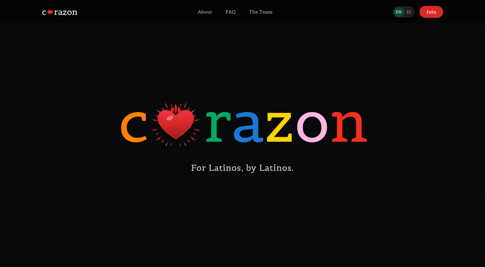
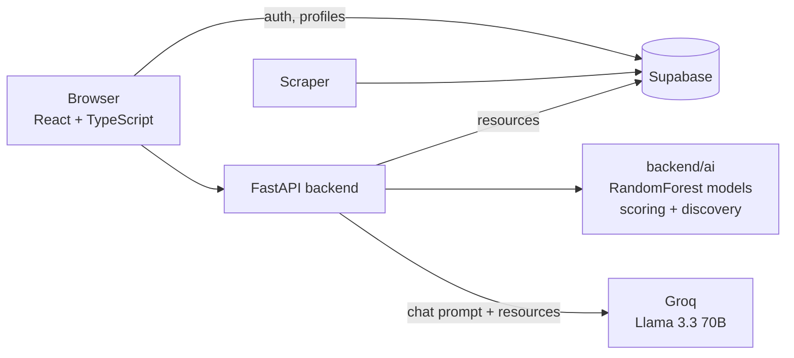

# Corazón

> Team project built at WildHacks 2026 (Northwestern) with [Nicolas Rufino](https://github.com/nicolasrufino) and [Diego](https://github.com/dflow11). Original repo: [nicolasrufino/Corazon](https://github.com/nicolasrufino/Corazon).>
> My role: system architect and AI/ML lead.

## Overview

Corazón is a bilingual (Spanish and English) resource platform for Latino communities in the U.S. Finding help is slow and confusing, and harder if you're undocumented or more comfortable in Spanish.

- Onboarding asks for immigration status, language and occupation, then ranks local resources: legal aid, clinics, food banks, jobs, scholarships.
- The chatbot, by text or voice, answers in the language you write in.
- Event discovery suggests community events that fit you.

`README-original.md` is the plan we wrote before the hackathon, and the build diverged from it. The plan used Claude Sonnet 4 through OpenRouter. What we shipped runs Llama 3.3 70B on Groq, and recommendations come from our own scoring code and models, not an LLM.

## My contributions

My code is in `backend/ai/`. That's 18 commits, mostly on `edug-0/ai-layer` and `feat/eddie-ai-voice-deploy` (merged in PR #8).

- The training pipeline: a synthetic data generator and `train_models.py`, which trains five RandomForest models. Four regressors estimate hours per year lost to navigating systems, the poverty premium, the total, and lifetime days, and a classifier predicts whether a resource is relevant to a user.
- The chatbot: Llama 3.3 70B through Groq, with English and Spanish search over the Supabase resources table. It can only cite resources from that list and falls back to the 211 helpline.
- Personalization: user archetypes and resource ranking. I moved the status, language and occupation multipliers into `routers/recommend.py`, replacing the Groq-based recommend endpoint.
- Event discovery: tag-weighted event scoring with language, age and eligibility bonuses, plus an isolation-hours estimate.
- The voice assistant on the frontend: speech-to-text with the Web Speech API and an ElevenLabs text-to-speech toggle.
- Smaller frontend work: the auth and onboarding redesign, headshots, and Spanish translation sync.

Diego moved the data layer from MongoDB to Supabase and built the dashboard redesign. Nicolas ran the frontend rebuild and the Vercel and Railway deploys.

## How it works

The frontend calls a FastAPI backend for anything AI or data related, and Supabase for auth and profiles. For a chat message, the backend pulls matching resources, puts them in the prompt, and sends it to Groq. The recommendation and discovery endpoints call my Python modules directly, and the saved models load once at startup.

## Challenges and what I learned

On Apr 12 my `chatbot.chat()` called Groq synchronously. Diego's code review (PR #4) pointed out that one in-flight chat would block the whole FastAPI event loop for the length of the Groq call, and he moved the call into `asyncio.to_thread`. The fix is his commit, not mine.

I also got the personalization classifier to 97.4% accuracy, which is its accuracy at predicting whether a resource is relevant to a user. I re-ran `train_models.py` on the 2,880 synthetic rows and got 97.4% on a held-out 20% (576 rows). The data is synthetic, generated from archetype rules, so the score shows the model learned those rules. I haven't tested it on real users.

The chatbot can't invent resources, because a made-up phone number is worse than no answer for someone looking for legal help. The prompt only allows organizations from the database list, uses their exact title, URL and description, and sends people to 211 when nothing matches.

What I learned: a synchronous SDK call inside an async FastAPI route blocks every other request. Use `asyncio.to_thread` or an async client.

It's still rough. There are no tests on the chatbot's answers, and I haven't measured how often it picks the right resource.
